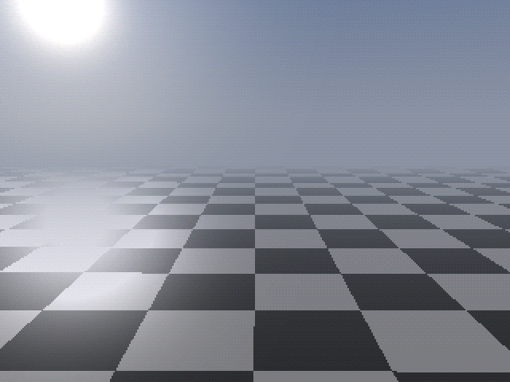
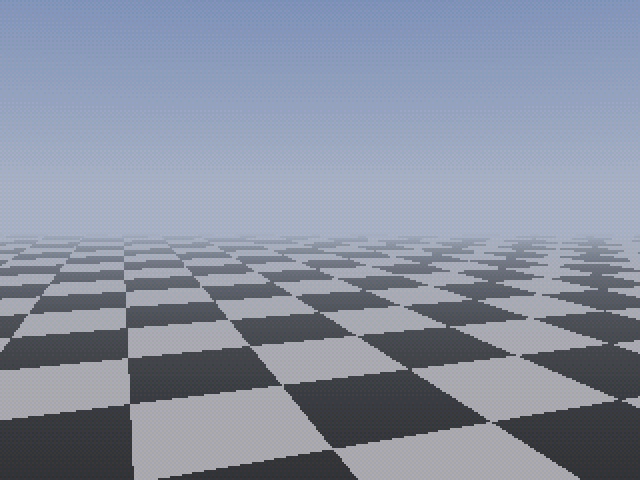

# Tang Nano 20K Ray Tracer

A real-time ray tracer in FPGA logic for the Sipeed Tang Nano 20K (Gowin
GW2AR-18), written in [Spade](https://spade-lang.org). The plan and its
LUT/DSP/BRAM budget are in [docs/PLAN.md](docs/PLAN.md).

**Status:** the display, memory and control path is built and verified in
simulation. It has not been tested on a board yet.

- 640×480@60 DVI out of the HDMI connector.
- A double-buffered 320×240 RGB565 framebuffer in the chip's embedded SDRAM.
  Buffers swap during vertical blanking, so there is no tearing.
- An orbit camera and a sun that move on their own or under control from the
  USB UART ([protocol](docs/uart-protocol.md)) and the two buttons.
- A first per-pixel ray renderer: sky, sun and a checkerboard floor with a sun
  glint. Spheres, shadows and reflections (plan milestones M2–M4) are next.

Frames from the full-system simulation, captured at the HDMI encoder and
identical to the Python model. Left: the first frame. Right: after
`W 02 3000`, `W 03 0400`, `W 0A 7000`, `W 0B 1800` and the keys `d` `l` over
the UART:

 

## Build and program

The build uses **Gowin EDA** (GowinSynthesis plus Gowin place and route)
through a normal Gowin project, `gowin/tn20k_raytracer/tn20k_raytracer.gprj`.
You also need [swim](https://codeberg.org/spade-lang/swim) to turn the Spade
sources into Verilog:

```
cargo install --git https://codeberg.org/spade-lang/swim
```

**In the Gowin IDE:**
1. Run `scripts/build.sh prepare`. It generates `build/spade_plain.v`, the
   Verilog the project uses. Run it again after every pull or `.spade` change:
   the IDE builds whatever is in that file. Its first line names the revision
   it was generated from.
2. Open `gowin/tn20k_raytracer/tn20k_raytracer.gprj` and press *Run All*.

**From the command line** (same project, headless `gw_sh`):

```
GOWIN_HOME=/path/to/Gowin scripts/build.sh   # -> gowin/tn20k_raytracer/impl/pnr/tn20k_raytracer.fs
openFPGALoader -b tangnano20k gowin/tn20k_raytracer/impl/pnr/tn20k_raytracer.fs   # load to SRAM
```

Notes on the Gowin flow:
- **Project contents:** the project lists the generated Verilog, the Verilog
  primitive wrappers in `rtl/`, and the pin and timing constraints
  (`constraints/tangnano20k.cst`, `constraints/tangnano20k.sdc`). Options are
  top module `top` and SystemVerilog 2017. `gowin/create_project.tcl`
  regenerates the project.
- **Timing-optimised settings:** `gowin/timing_options.tcl` holds the
  settings, taken from SUG1220-2.1E.
  - Synthesis: `-opt_goal timing`, `-map_option 3` and `-netlist_hierarchy 0`
    (flatten). `-map_option 4` and a lower `-max_fanout` buy more speed for
    more LUTs; the design needs 54 MHz and has a large margin.
  - Place and route: timing-driven, `-place_option 2`, `-route_option 1`,
    resource replication, `-retiming_resource all`, clocks routed fastest
    first, hold fixing, and I/O registers in the IOBs.
  - `scripts/build.sh` applies them on every build. The committed project
    stores the place-and-route ones. Releases older than the 2.0E command set
    (for example V1.9.11.03) skip the newer synthesis options with a message.
  - In the IDE, run `source <repo>/gowin/timing_options.tcl` once in the Tcl
    console and save the project, so your release stores all of them.
- **Headless Linux:** `scripts/build.sh` sets `QT_QPA_PLATFORM=offscreen`, so
  no display is needed. It also preloads the system libfreetype, because some
  Gowin releases bundle one that breaks on current distributions.
- **Escaped identifiers:** Spade names anonymous registers `\_`, and Gowin's
  place and route cannot read those back from the synthesised netlist.
  `scripts/plain_identifiers.py` (run by `prepare`) rewrites them;
  `PLAIN=1 sim/run.sh` simulates the rewritten file.
- **Large constants:** Gowin rejects constants over 2^16 bits, so the sine
  table is stored as a quarter wave.

`scripts/build_oss.sh` is the open-source alternative (Yosys, nextpnr-himbaechel,
apicula). It produced the only full build so far:

| LUT4 | Flip-flops | Block RAM | 18×18 multipliers | PLLs | fmax core / pixel (needed) |
|------|-----------|-----------|-------------------|------|----------------------------|
| 6,100 / 20,736 (29 %) | 3,725 / 15,552 | 10 / 46 | 29 / 48 (+7 9×9) | 2 / 2 | 146.6 / 85.8 MHz (54 / 25.2) |

## Control it

Open the board's serial port at 115200 baud and press keys:

- `a` / `d`: orbit the camera
- `w` / `s`: raise or lower the camera
- `z` / `x`: zoom in or out
- `j` / `l`: move the sun's azimuth
- `i` / `k`: raise or lower the sun
- `o`: camera auto-orbit on/off
- `p`: sun motion on/off
- `t`: test pattern
- `c`: reset to defaults

The host tool takes values in real units:

```
pip install pyserial
tools/rtctl.py /dev/ttyUSB1 dump
tools/rtctl.py /dev/ttyUSB1 set yaw 45 dist 4.5 fov 70 sun_el 20 orbit off
tools/rtctl.py /dev/ttyUSB1 keys
```

LEDs, from `led[0]`:
- `led[0]` frame heartbeat
- `led[1]` SDRAM ready
- `led[2]` orbit on
- `led[3]` sun motion on
- `led[4]` UART activity
- `led[5]` freeze

## Test

```
swim test        # cocotb unit tests: rsqrt unit, camera setup, UART + command parser
sim/run.sh       # full system in Verilator: SDRAM and DVI models, scripted UART session,
                 # 3 frames compared bit for bit with model/hw.py (needs Verilator 5)
PLAIN=1 sim/run.sh   # the same on the identifier-rewritten Verilog that Gowin EDA builds
sim/check_clocks.sh  # PLLs, dividers and HDMI serialisers with Gowin's primitive models
                     # (needs GOWIN_HOME)
```

`model/hw.py` is a bit-exact Python model of the RTL arithmetic. The tests
compare against it, and the system simulation also checks the SDRAM protocol,
SDRAM timing and TMDS symbols.

## Layout

```
src/            Spade RTL (main.spade is the top level)
rtl/            Verilog: Gowin primitive wrappers, SDRAM read capture
constraints/    pin (.cst) and timing (.sdc) constraints
gowin/          Gowin EDA project (.gprj) and gw_sh scripts
test/           cocotb tests          sim/      system testbench and models
model/          Python models         scripts/  build and table generation
tools/          host tools            docs/     plan, UART protocol
```
