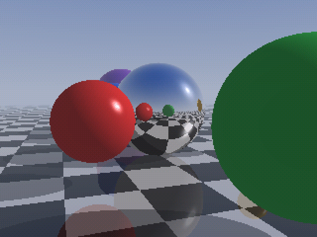
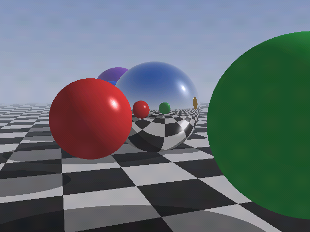

# Tang Nano 20K Ray Tracer

A real-time ray tracer in FPGA logic for the Sipeed Tang Nano 20K (Gowin
GW2AR-18), written in [Spade](https://spade-lang.org). The plan and its
LUT/DSP/BRAM budget are in [docs/PLAN.md](docs/PLAN.md).

**Status:** milestones M0–M5 are built and verified in simulation, bit for bit
against the Python model. Nothing has run on a board yet.

- A Whitted ray tracer in logic: six animated spheres (a mirror, glossy and
  matt ones) over a checkerboard floor, a sun with hard shadows, Lambert and
  ambient light, Phong highlights, reflections with up to three bounces, a
  sky gradient with sun glow, and distance fog.
- Scanline-batched passes over one shared intersection unit and one shading
  unit ([plan](docs/PLAN.md) §4.2). Per-frame screen boxes for every sphere
  and its shadow let each line test only the spheres that can touch it.
- 640×480 at the display's full 60 fps for the default scene, with a 75 MHz
  core clock (key `v` or button S2): each frame traces one checkerboard half
  of the pixels, and the display takes the other half from the previous
  frame. The tracer alone would manage about 61 fps for the default view (a
  low sun), 67 fps with the sun at 22° and 74 at 34°; a reflective floor
  (kr ¼) brings it down to about 44 fps.
- 320×240 (pixel-doubled) traces in about half the time, also shown at
  60 fps.
- 640×480@60 DVI out of the HDMI connector, from a triple-buffered RGB565
  framebuffer in the chip's embedded SDRAM. Buffers swap during vertical
  blanking, so there is no tearing.
- An orbit camera, a moving sun and moving spheres, controlled from the USB
  UART ([protocol](docs/uart-protocol.md)) and the two buttons.

Frames from the full-system simulation, captured at the HDMI encoder and
identical to the Python model. Left: the first frame. Right: after UART
commands that move the camera and sun, advance the animation and make the
floor reflective. Below: the same view in the 640×480 mode, merged from two
checkerboard frames.

 


## Build and program

The build uses **Gowin EDA** (GowinSynthesis plus Gowin place and route)
through a normal Gowin project, `gowin/tn20k_raytracer/tn20k_raytracer.gprj`.
You also need [swim](https://codeberg.org/spade-lang/swim) to turn the Spade
sources into Verilog:

```
cargo install --git https://codeberg.org/spade-lang/swim
```

**In the Gowin IDE:**
1. Run `scripts/build.sh prepare`. It generates `build/spade_plain.v`, the
   Verilog the project uses. Run it again after every pull or `.spade` change:
   the IDE builds whatever is in that file. Its first line names the revision
   it was generated from.
2. Open `gowin/tn20k_raytracer/tn20k_raytracer.gprj` and press *Run All*.

**From the command line** (same project, headless `gw_sh`):

```
GOWIN_HOME=/path/to/Gowin scripts/build.sh   # -> gowin/tn20k_raytracer/impl/pnr/tn20k_raytracer.fs
openFPGALoader -b tangnano20k gowin/tn20k_raytracer/impl/pnr/tn20k_raytracer.fs   # load to SRAM
```

**Core clock.** The core runs at 75 MHz (place and route: 75.1 MHz fmax).
Set another one with `CORE_MHZ`, from 25 to 100 MHz:

```
CORE_MHZ=66 scripts/build.sh prepare      # then Run All in the IDE, or:
CORE_MHZ=66 GOWIN_HOME=/path/to/Gowin scripts/build.sh
```

`scripts/clock_config.py` picks the closest PLL setting that is not faster
than asked for, and prints it. It writes `build/clocks.v` (the PLL) and
`build/tangnano20k.sdc` (the timing constraint), which the Gowin project
builds; the UART divider and SDRAM refresh interval come with them. The
frame rate scales with the clock. `rtctl.py get core_clock` reads it back
from the board. `CORE_MHZ` works the same for `sim/run.sh`,
`sim/check_clocks.sh` and `scripts/build_oss.sh`.

Notes on the Gowin flow:
- **Project contents:** the project lists the generated Verilog
  (`build/spade_plain.v`, `build/clocks.v`), the Verilog primitive wrappers
  in `rtl/`, and the pin and timing constraints (`constraints/tangnano20k.cst`,
  `build/tangnano20k.sdc`). `rtl/gowin/clocks.v` and
  `constraints/tangnano20k.sdc` are the templates for the generated copies. Options are
  top module `top` and SystemVerilog 2017. `gowin/create_project.tcl`
  regenerates the project.
- **Implementation settings:** `gowin/timing_options.tcl` holds them
  (option names from SUG1220-2.1E). The design fills about 70 % of the
  logic, so they favour routability: with the timing-first algorithms, place
  and route left thousands of nets unrouted (PR0004).
  - Synthesis: `-opt_goal timing`, default LUT mapping (`-map_option 0`) and
    `-netlist_hierarchy 0` (flatten).
  - Place and route: timing-driven, `-place_option 1` (routability
    priority), `-route_option 0` (the default router, which routes around
    congestion), no resource replication, clocks routed fastest first, hold
    fixing, and I/O registers in the IOBs.
  - `scripts/build.sh` applies them on every build, and the committed project
    stores the place-and-route ones. Releases older than the 2.0E command set
    (for example V1.9.11.03) skip the newer synthesis options with a message.
  - Run `GOWIN_HOME=/path/to/Gowin scripts/build.sh options` once, with the
    project closed in the IDE, to store all the settings your release
    supports. It prints `set` or `SKIPPED` for each one and lists every
    option the project uses in `build/gowin_options.tcl`. (In the IDE's Tcl
    console, not a shell, `source <repo>/gowin/timing_options.tcl` does the
    same.)
- **Headless Linux:** `scripts/build.sh` sets `QT_QPA_PLATFORM=offscreen`, so
  no display is needed. It also preloads the system libfreetype, because some
  Gowin releases bundle one that breaks on current distributions.
- **Escaped identifiers:** Spade names anonymous registers `\_`, and Gowin's
  place and route cannot read those back from the synthesised netlist.
  `scripts/plain_identifiers.py` (run by `prepare`) rewrites them;
  `PLAIN=1 sim/run.sh` simulates the rewritten file.
- **Constant bit indices:** Gowin EDA (V1.9.12.04) reads a bit-select whose
  index is a 1-bit `localparam` set to 1 (Spade's `x.as_bits()[1]` on a
  2-bit value) as bit 0. On the board that flipped the sign of the sine
  lookups: the camera was upside down and the spheres misplaced, while the
  simulation was right. `scripts/plain_identifiers.py` now writes every such
  index as a literal, and the two sine lookups no longer use the construct.
  `tools/rtctl.py PORT debug` and `trig` compare the board's camera, boxes
  and sines with the model.
- **Large constants:** Gowin rejects constants over 2^16 bits, so the sine
  table is stored as a quarter wave.
- **NL0002 "module ... is swept in optimizing":** expected, a few hundred of
  them. Spade emits every function as its own small Verilog module. After
  flattening, many of those end up with no cells of their own, so Gowin
  reports them as swept. The logic itself is still there:
  - Conversions, concatenations, truncations and constant functions are pure
    wiring.
  - Some logic moves into a neighbouring cell. For example, the fog
    multiply-adds become `MULTADDALU18X18` blocks, and each rsqrt table
    becomes a block RAM (`pROMX9`) in the pipeline around it.

  A synthesis of the renderer alone shows the expected 2 `pROMX9` (rsqrt
  tables) and 2 `pROM` (pow and sun tables).

`scripts/build_oss.sh` is the open-source alternative (Yosys, nextpnr-himbaechel,
apicula); it has not been run on the tracer.

Resources from a GowinSynthesis run of the checkerboard version at 54 MHz
(V1.9.11.03, synthesis only, before place and route, so fmax is an
estimate):

| Logic (LUT + ALU + RAM16) | Registers | Block RAM | 18×18 multipliers | PLLs | core fmax estimate |
|---------------------------|-----------|-----------|-------------------|------|--------------------|
| 14,374 / 20,736 (70 %) | 6,412 / 15,552 | 35 / 46 | ≈ 44.5 / 48 | 2 / 2 | 63.3 MHz |

The 75 MHz version adds pipeline registers (about 1,300 more flip-flops).
Its place and route (V1.9.12.04) meets timing: core 75.1 MHz (75 needed),
pixel clock 76.6 MHz (25.2 needed), serial clock 380 MHz (126 needed).

The multiplier count adds up 18 MULT18X18, 11 MULTADDALU18X18 and 2
MULTALU36X18 (two multipliers each), and 1 MULT9X9. The colour products are
built from logic to leave the DSPs to the vector maths. The synthesis
estimate does not apply the constraint file's asynchronous clock groups, so
its worst paths are clock-domain crossings that place and route ignores; the
place-and-route timing report is the one that counts.

## Control it

Open the board's serial port at 115200 baud, 8N1, no flow control, and press
keys (lower case):

- `a` / `d`: orbit the camera
- `w` / `s`: raise or lower the camera
- `z` / `x`: zoom in or out
- `j` / `l`: move the sun's azimuth
- `i` / `k`: raise or lower the sun
- `o`: camera auto-orbit on/off
- `p`: sun motion on/off
- `m`: sphere motion on/off
- `v`: 640×480 mode on/off
- `b`: reflection bounces (0–3)
- `r`: floor reflectivity (0, ¼, ½, ¾)
- `t`: test pattern
- `c`: reset to defaults

The host tool takes values in real units. Linux or macOS:

```
pip install pyserial
tools/rtctl.py list                             # find the port
tools/rtctl.py /dev/ttyUSB1 dump
tools/rtctl.py /dev/ttyUSB1 set yaw 45 dist 4.5 fov 70 sun_el 20 orbit off
tools/rtctl.py /dev/ttyUSB1 get cycles          # frame time and fps
tools/rtctl.py /dev/ttyUSB1 keys                # single keys, q or Esc quits
tools/rtctl.py /dev/ttyUSB1 debug               # camera and boxes vs. the model
```

Windows (Command Prompt or PowerShell, Python from python.org):

```
py -m pip install pyserial
py tools\rtctl.py list                          # e.g. COM5  USB Serial Port (COM5)
py tools\rtctl.py COM5 dump
py tools\rtctl.py COM5 set quality on bounces 2
py tools\rtctl.py COM5 keys
```

Notes for Windows:
- **Finding the port.** The board's USB connector shows up as two devices:
  JTAG for programming, and the UART. The UART is the COM port, usually the
  higher-numbered one. Device Manager lists it under *Ports (COM & LPT)*.
- **Missing COM port.** If you installed WinUSB with Zadig for openFPGALoader
  and the COM port disappeared, Zadig replaced the driver on the UART
  interface too. Give WinUSB only to interface 0 (JTAG), and put interface 1
  back on its serial driver.
- **One program at a time.** Only one program can hold a COM port, so close
  PuTTY or the Gowin programmer before running `rtctl.py`.
- **Plain terminals.** For a terminal instead of the tool, PuTTY (*Serial*,
  115200) or Tera Term (*Setup → Serial port*, 115200, 8N1, no flow control)
  both work for the single keys and the `W`/`R` line commands.

Buttons: **S1** pauses or resumes all motion, **S2** switches the 640×480 mode.

The checkerboard halves come from consecutive frames, so a fast-moving
object shows a fine comb pattern along its edges while it moves. A still
picture is exact: two frames of a still scene give the full 640×480 image.

LEDs, from `led[0]`:
- `led[0]` frame heartbeat
- `led[1]` SDRAM ready
- `led[2]` orbit on
- `led[3]` sun motion on
- `led[4]` UART activity
- `led[5]` freeze

## Test

```
swim test        # cocotb unit tests against model/hw.py: rsqrt unit, camera setup, animator,
                 # ray unit, shading unit, screen-box projector, UART + command parser
sim/run.sh       # full system in Verilator: SDRAM and DVI models, scripted UART session,
                 # 4 frames (320x240 and 640x480) compared bit for bit with model/hw.py
                 # (needs Verilator 5, about 3 minutes)
PLAIN=1 sim/run.sh   # the same on the identifier-rewritten Verilog that Gowin EDA builds
sim/check_clocks.sh  # PLLs, dividers and HDMI serialisers with Gowin's primitive models
                     # (needs GOWIN_HOME)
```

`model/hw.py` is a bit-exact Python model of the RTL arithmetic: each pipeline
has a reference function, and the frame renderer is built from them. The
tests compare against it, and the system simulation also checks the SDRAM
protocol, SDRAM timing and TMDS symbols.

## Layout

```
src/            Spade RTL (main.spade is the top level)
rtl/            Verilog: Gowin primitive wrappers, SDRAM read capture
constraints/    pin (.cst) and timing (.sdc) constraints
gowin/          Gowin EDA project (.gprj) and gw_sh scripts
test/           cocotb tests          sim/      system testbench and models
model/          Python models         scripts/  build and table generation
tools/          host tools            docs/     plan, UART protocol
```
