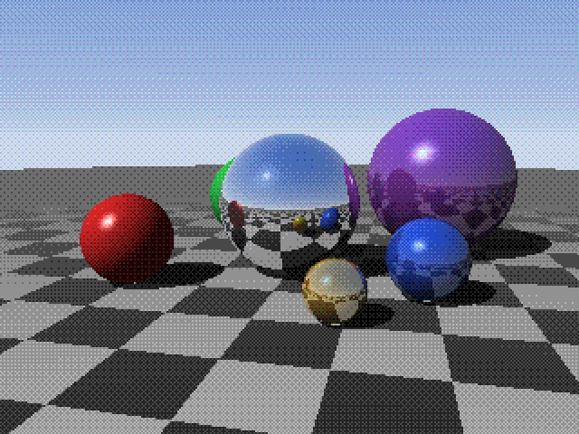
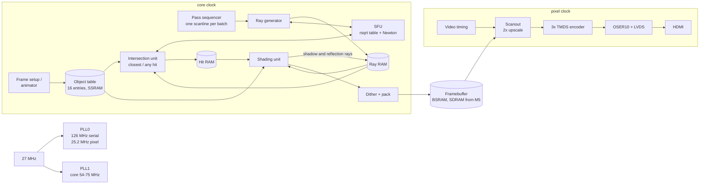

# Tang Nano 20K Ray Tracer: Project Plan

Target: Sipeed Tang Nano 20K (Gowin GW2AR-LV18QN88C8/I7).

## Status

Built and verified in simulation, not yet tested on a board:

- **M1:** 640×480@60 DVI out of the HDMI connector, with clocks, scanout and UART.
- **M5, brought forward:** a double-buffered 320×240 RGB565 framebuffer in the
  embedded SDRAM, with buffer swaps during vertical blanking (no tearing). It
  replaces the block-RAM framebuffer planned for the MVP, so the 38 block RAMs
  that framebuffer would have used stay free from the start.
- **Camera and sun motion:** an orbit camera and a sun, set by a microcoded
  per-frame setup unit on one shared multiplier. Both can move on their own.
- **UART control:** register read/write commands plus single-key nudges
  ([uart-protocol.md](uart-protocol.md)) and a host tool (`tools/rtctl.py`).
- **First renderer:** a per-pixel ray pipeline (ray generator plus two rsqrt
  units) drawing sky, sun and a checkerboard floor with a sun glint. It
  exercises the camera, light and framebuffer path ahead of the sphere
  intersection unit (M2).

The RTL is in Spade rather than Verilog (§6). The sections below are the
original plan; M2–M4 (spheres, shadows, reflections) come next.

## 1. Goal

Build a real-time, Whitted-style ray tracer entirely in FPGA logic, with no CPU
in the render loop, that drives a monitor through the board's HDMI connector.
The demo shows the classic scene: mirror and glossy spheres over a checkerboard
floor, lit by a sun, with hard shadows, reflections, specular highlights and a
sky gradient, all animated.

The demo is complete (end of M4) when it has:

- 640×480 @ 60 Hz DVI output, with a 320×240 internal render that is pixel-doubled.
- At least 25 fps animated, with 6–8 spheres, the floor, shadows, one reflection
  bounce and specular highlights.
- No more than 75 % of the LUT4s (about 15.5 K of 20,736) used once all
  Tier 0–2 features are in, and timing met at a core clock of 54 MHz or more.
- RTL output that matches the Python golden model bit for bit.

## 2. The budget, and what runs out first

| Resource (GW2AR-18)        | Available        | Planned, Tier 0–2 |
|----------------------------|------------------|-------------------|
| LUT4                       | 20,736           | ~9 K (~11.6 K with 30 % contingency) |
| Flip-flops                 | 15,552           | ~7.9 K            |
| Block SRAM (18 Kbit)       | 46               | 21 (45 before the framebuffer moves to SDRAM) |
| Shadow SRAM                | 41,472 bit       | ~2 Kbit (object table) |
| 18×18 multipliers (DSP)    | 48               | 43                |
| PLLs                       | 2                | 2                 |
| Embedded SDR SDRAM         | 64 Mbit, 32-bit  | framebuffers (M5+) |

Board parts used: 27 MHz oscillator, HDMI connector, buttons S1/S2, 6 LEDs,
USB-UART through the BL616, and the embedded SDRAM (from M5).

**The 20 K LUTs are not the first limit.** Ray tracing is multiply-bound: one
sphere test needs 7 multiplies and a square root. On this part the 48 hardware
multipliers and 46 block RAMs run out long before the LUTs do. So the budget is
tracked in the order **DSP → BSRAM → LUT → FF**, and the architecture follows
five rules:

1. **One of each expensive unit, shared by every ray type.** Primary, shadow
   and reflection rays all go through the same intersection unit. A new ray
   type costs cycles and a little control logic, not another datapath.
2. **One special-function unit (SFU) for every root and division.** A single
   rsqrt table plus one Newton step gives `rsqrt(x)`, `sqrt(x) = x·rsqrt(x)` and
   `1/x = rsqrt(x)²`.
3. **Adders live inside the DSP blocks.** `MULTADDALU18X18` and `MULTALU18X18`
   compute `a·b ± c·d` plus an accumulator, so a 3-term dot product costs
   almost no LUTs.
4. **18-bit fixed point** wherever a multiplier is involved, to match
   `MULT18X18`. No floating point: a single FP32 adder costs about 500 LUTs.
5. **LUTs are the spare resource.** If the DSPs run out, small (≤ 9-bit) colour
   multiplies move into fabric at about 80 LUTs each.

## 3. What the demo shows

- **Scene:** 6–8 spheres (one large mirror, glossy coloured ones with different
  reflectivity), an infinite checkerboard floor that fades towards the
  horizon, and a sky gradient with a sun disc and glow.
- **Lighting:** a directional sun, Lambert diffuse plus ambient, hard shadows,
  Phong highlights, and 1–2 reflection bounces.
- **Motion:** spheres bounce and drift on sine paths, the camera orbits the
  scene, and the sun angle can sweep.
- **Controls:** S1 pauses or steps to the next scene preset. S2 switches mode
  (real-time 320×240 or, after M5, quality 640×480). LEDs show the mode and a
  frame heartbeat. The UART prints cycles per frame.

Expected look, rendered by the fixed-point feasibility model
([`model/feasibility.py`](../model/feasibility.py)) at 320×240 in RGB333 with
ordered dither, pixel-doubled to 640×480:



## 4. Architecture

### 4.1 Block diagram



### 4.2 Scanline-batched passes

A batch is one 320-pixel scanline. The sequencer runs a fixed list of passes
over it, and each pass streams its active rays through one unit at one per clock:

| # | Pass          | Unit                                         | Cycles per scanline |
|---|---------------|----------------------------------------------|---------------------|
| 1 | GEN           | Ray generator + SFU                          | 320                 |
| 2 | ISECT primary | IU, closest hit                              | (S + 1) × 320       |
| 3 | SHADE 1       | SU: shade hits, sky for misses, emit secondary rays | 320          |
| 4 | SHADOW 1      | IU, any hit, spheres only                    | S × n_lit           |
| 5 | ISECT reflect | IU, closest hit                              | (S + 1) × n_refl    |
| 6 | SHADE 2       | SU                                           | n_refl              |
| 7 | SHADOW 2      | IU, any hit                                  | S × n_lit2          |
| – | WRITE         | Pixel out                                    | overlaps the last SHADE |

S is the number of spheres; the floor is the "+ 1". Each pass also costs about
32 cycles to fill and drain the pipeline. Extra bounces repeat passes 5–7.

Why this is cheap:

- **Object-major streaming.** The IU runs `for each object: for each ray in the
  batch`. The current object's parameters stay in a register for a whole sweep,
  so the object table can be a narrow, slow memory. Each ray's best hit is
  read, compared and written back in the Hit RAM. Updates to the same ray are
  at least one batch length apart, so there are no hazards and no stalls. Very
  short secondary batches are padded to at least 8 slots.
- **Stream compaction.** SHADE writes the rays it spawns densely, each with its
  9-bit pixel index, so secondary passes only spend cycles on rays that exist.
  Sky pixels cost nothing after SHADE 1. The hardware is a write counter, about
  20 LUTs.
- **Sharing comes from the schedule.** GEN and ISECT never run at the same time,
  so they share the SFU through a mux. SU and IU never overlap either, which
  leaves room to share DSPs later (Tier 3).

Throughput from the feasibility model, assuming one IU test per clock and
32 cycles of fill and drain per pass:

| Scene                          | Render  | Cycles/pixel | fps @ 54 MHz | fps @ 75 MHz |
|--------------------------------|---------|-------------:|-------------:|-------------:|
| 6 spheres + floor, 1 bounce    | 320×240 | 15.1         | 46           | 65           |
| 6 spheres + floor, no bounce   | 320×240 | 13.1         | 54           | 74           |
| 12 spheres + floor, 1 bounce   | 320×240 | 26.8         | 26           | 36           |
| 6 spheres + floor, 1 bounce    | 640×480 | 14.8         | 12           | 16           |

As a rule of thumb, cycles per pixel ≈ 1.75·S + 4.5. Real-time (25 fps or
more) holds up to about 12 spheres at 54 MHz. 640×480 is an interactive
"quality" mode, not a real-time one.

Rendering is decoupled from display: the tracer draws as fast as it can, and
scanout shows the framebuffer at 60 Hz.

### 4.3 Number formats

| Quantity                                   | Format                        | Notes |
|--------------------------------------------|-------------------------------|-------|
| Positions, distance t                      | s5.12 (18 bit)                | ±32 units, step 1/4096 |
| Directions, normals                        | s1.16 (18 bit)                | unit vectors |
| Ray-generator accumulators                 | s1.24 (26 bit, adders only)   | keeps per-pixel increments from drifting the FOV |
| Dot products, `L·L − r²`, discriminant     | up to 48 bit, inside the DSP ALU | never truncated before the SFU |
| SFU mantissa                               | u2.16 (unsigned DSP mode)     | [1, 4) |
| Light / colour                             | u1.8 light, 8 bit per channel | |
| Framebuffer, MVP                           | RGB333 + 4×4 Bayer dither     | 9 bits use the BSRAM's parity bit for free; 512 colours |
| Framebuffer, M5+                           | RGB565 in SDRAM               | |

Results from `python3 model/feasibility.py`:

- **Every multiplier operand fits in 18 bits.** The one exception was
  `L = C − O` for secondary rays that start far out on the floor. It now
  saturates at ±32 units and counts as a miss. t is capped at 32 units anyway,
  so this only drops hits at the far edge of the range.
- **PSNR is 37 dB against a float64 render.** 0.4 % of pixels differ by more
  than 16/255, all on silhouettes, checker edges and highlight centres. One
  RGB333 step is 36/255, so the fixed-point error doesn't show on screen.
- **No shadow acne** with a `P + N/128` shadow-ray origin offset.

### 4.4 Units

**SFU** (shared, one operation per clock, about 12 pipeline stages):

1. Leading-zero count on x (up to 48 bits), then an even shift that normalises
   it to m ∈ [1, 4).
2. Look up rsqrt in a 768-entry table (one BSRAM in 1K×18 mode). The 256 spare
   entries hold a quarter-wave sine table for the animator.
3. One Newton step, `y·(3 − m·y²)/2` (3 DSP).
4. Either `m·y` for sqrt or `y²` for the reciprocal, then an exponent shift.

That gives about 20-bit accuracy for 5 DSP, 1 BSRAM and about 400 LUTs.

**Intersection unit (IU)**

- Sphere, with D a unit vector: `L = C − O`, `b = L·D`, `c = L·L − r²`,
  `disc = b² − c`, `t = b − √disc`. 7 DSP plus the SFU.
- Floor (y = 0): `t = O.y · (1 / −D.y)`. The reciprocal comes from the SFU slot
  that a sphere test uses for √, plus 1 DSP.
- Two modes. *Closest hit* writes t and the object id to the Hit RAM. *Any hit*
  is for shadow rays and tests spheres only, since the sun is always above the
  floor. A hit counts only if ε < t < t_best.

**Shading unit (SU)** (fully pipelined, one ray per clock)

- `P = O + t·D`, then `N = (P − C)·(1/r)`. 1/r is stored per object, so no SFU
  is needed. Then `N·L`, combined with the shadow bit from the shadow pass.
- Floor albedo is a checker: XOR of the integer bits of P.x and P.z. Its
  contrast fades with t, which is cheap anti-aliasing at the horizon.
- Misses get the sky gradient `horizon + (zenith − horizon)·D.y`. This reuses
  the albedo multipliers, which misses don't otherwise use. The sun comes from
  a table indexed by `D·L`.
- Tier 1 adds `R = D − 2(D·N)N`, a Phong highlight from a pow table indexed by
  `R·L`, and a reflection mix with kr ∈ {0, ¼, ½, ¾} done with shifts.
- Output: saturate, apply the 4×4 Bayer dither, pack as RGB333.

**Ray generator.** `d = F + x·dU + y·dV` is built with incremental 26-bit adders,
with no multiplies. Then `D = d · rsqrt(d·d)` (6 DSP plus the SFU). F, dU and
dV come from frame setup.

**Frame setup / animator** (MVP). This runs once per frame, in the tracer's idle
gap.

- A phase accumulator and the sine table drive the sphere paths (an `|sin|`
  bounce and circular drift).
- The orbit camera's basis is computed directly from the sine and cosine of the
  orbit angle, so it needs no normalisation.
- It writes the object table and F/dU/dV, using one DSP in sequence (about 200
  multiplies per frame).

A soft CPU replaces it in Tier 2.

**Memories**

| Memory          | Contents (bits)                                         | Implementation |
|-----------------|---------------------------------------------------------|----------------|
| Ray RAM         | O.xyz s5.12, D.xyz s1.16 (108)                          | 3 BSRAM, 512×36 semi-dual-port |
| Hit RAM         | t (18), object id (4)                                   | 1 BSRAM, one read and one write per clock |
| Shade-state RAM | pixel x (9), accumulated RGB (24), throughput (3)       | 1 BSRAM |
| Object table    | C, r², 1/r, albedo, kr, material (~128) × 16            | Shadow SRAM, which suits 16-deep tables |
| SU tables       | pow (4 shininess × 256 × 8), sun (256 × 8)              | 1 BSRAM |
| SFU table       | rsqrt (768 × 17) + sine (256 × 18)                      | 1 BSRAM, true dual-port |
| Framebuffer     | 320 × 240 × 9                                           | 38 BSRAM (2K×9), dual-clock |

### 4.5 Clocks and video

- **PLL0:** 27 MHz → 126 MHz TMDS serial clock. CLKDIV ÷5 → 25.2 MHz pixel
  clock. With 800×525 total that is 60.0 Hz, which monitors accept as
  640×480@60.
- **PLL1:** 27 MHz → core clock. Start at 54 MHz and raise it to 75 MHz once
  timing is known. The SDRAM shares this domain from M5.
- **Clock crossing:** the framebuffer BSRAM is dual-clock (the core clock
  writes, the pixel clock reads). Frame-start and vsync flags cross through
  2-FF synchronisers.
- **Resolution:** 640×480 needs only a 126 MHz serialiser, comfortably within
  the part's limits. 720p (a 371.25 MHz serialiser) is deliberately out of
  scope.

## 5. Feature tiers and resource budget

These are per-block estimates made before any synthesis. The totals carry a
30 % LUT contingency, and real numbers replace them at every milestone (§7).

### Tier 0: MVP (M1–M3)

| Block                                                    | LUT4  | FF    | BSRAM | DSP |
|----------------------------------------------------------|------:|------:|------:|----:|
| Clocks, reset, buttons, LEDs, debug UART                 | 250   | 200   | 0     | 0   |
| DVI TX 640×480 (timing, 3× TMDS encoder, OSER10)         | 350   | 250   | 0     | 0   |
| Framebuffer 320×240 RGB333 + 2× scanout                  | 400   | 150   | 38    | 0   |
| Pass sequencer, scanline scheduler, compaction           | 450   | 300   | 0     | 0   |
| Ray / Hit / shade-state RAMs and glue                    | 250   | 100   | 5     | 0   |
| Object table (shadow SRAM, 16 entries)                   | 200   | 50    | 0     | 0   |
| Ray generator                                            | 300   | 400   | 0     | 6   |
| SFU                                                      | 400   | 500   | 1     | 5   |
| Intersection unit (sphere + floor, closest / any hit)    | 800   | 1,200 | 0     | 8   |
| Shading unit (diffuse, shadows, checker, sky, sun, dither) | 800 | 1,200 | 1     | 12  |
| Frame setup / animator (uses the SFU table's sine)       | 500   | 400   | 0     | 1   |
| **Tier 0 total**                                         | **4,700** | **4,750** | **45** | **32** |

### Tier 1: what makes it look like a ray tracer (M4)

| Feature                                         | LUT4 | FF  | BSRAM | DSP | Cycle cost |
|-------------------------------------------------|-----:|----:|------:|----:|-----------|
| Reflections, 1 bounce (R, spawn, mix, extra passes) | 400 | 500 | 0  | 6   | +2.0 cycles/pixel |
| Extra bounces (sequencer loop, depth 2–3)       | 100  | 50  | 0     | 0   | about +0.4 cycles/pixel per bounce |
| Phong specular (`R·L` + pow table)              | 150  | 150 | 0     | 3   | none |
| Horizon fade / floor fog                        | 100  | 50  | 0     | 0   | none |
| Sun disc and glow                               | 50   | 30  | 0     | 0   | none |
| **Tier 1 total**                                | **800** | **780** | **0** | **9** | |

### Tier 2: polish, needs the SDRAM framebuffer (M5–M6)

| Feature                                                                  | LUT4  | FF    | BSRAM    | DSP |
|--------------------------------------------------------------------------|------:|------:|---------:|----:|
| SDRAM controller, line FIFOs, double buffering (framebuffer leaves BSRAM) | 900  | 700   | −38 + 4  | 0   |
| RGB565 colour path                                                       | 50    | 50    | 0        | 0   |
| Soft CPU scene processor (RV32I, e.g. PicoRV32 or VexRiscv-min), 16 KB RAM, bus | 1,800 | 1,200 | +8 | 0   |
| Remove the hardwired animator (the CPU takes over)                       | −500  | −400  | 0        | −1  |
| UART console for live scene edits from a PC through the BL616            | 150   | 100   | 0        | 0   |
| Quality mode: 640×480 with progressive jittered AA, accumulated in SDRAM | 600   | 400   | +2       | 0   |
| Procedural solid textures on spheres (stripes, 3D checker, XOR "marble" from P bits) | 200 | 100 | 0 | 0 |
| Second light (one more shadow pass, second `N·L`)                        | 250   | 200   | 0        | 3   |
| **Tier 2 total**                                                         | **3,450** | **2,350** | **−24** | **+2** |

### Tier 3: stretch (M7)

| Feature                                                                  | LUT4  | FF    | BSRAM | DSP |
|--------------------------------------------------------------------------|------:|------:|------:|----:|
| Refraction / glass sphere (Snell + total internal reflection). Shares the SFU with the SU and borrows the 6 ray-generator DSPs, which sit idle during SHADE | 900 | 800 | 0 | 0 new |
| HUD text overlay (fps, scene name; 8×8 font)                             | 250   | 100   | 1     | 0   |
| Depth of field and soft shadows in quality mode (LFSR-jittered origin / light) | 250 | 150 | 0  | 0   |
| Axis-aligned boxes: slab test on the sphere multipliers that boxes leave idle; 3 SFU reciprocals per ray | 700 | 600 | 0 | 0 new |
| **Tier 3 total**                                                         | **2,100** | **1,650** | **1** | **0 new** |

### Totals

| Cumulative              | LUT4                    | FF            | BSRAM   | DSP           |
|-------------------------|------------------------:|--------------:|--------:|--------------:|
| Tier 0                  | 4,700                   | 4,750         | 45 / 46 | 32 / 48       |
| Tier 0–1 (demo-complete) | 5,500                  | 5,530         | 45 / 46 | 41 / 48       |
| Tier 0–2                | 8,950                   | 7,880         | 21 / 46 | 43 / 48       |
| Tier 0–3                | 11,050                  | 9,530         | 22 / 46 | 43 / 48, plus sharing |
| Tier 0–3 with contingency (30 % LUT, 15 % FF) | **~14,400 (69 %)** | ~11,000 (71 %) | | |

Everything planned, including the stretch tier and the contingency, lands at
about 70 % of the LUTs. That leaves the place-and-route headroom the 75 %
target asks for.

### Out of scope, and why

- **Triangle meshes / BVH.** Möller–Trumbore needs about 27 multiplies per test
  plus a traversal stack. There is no DSP budget for it.
- **Floating point.** One FP32 adder alone is about 500 LUTs, and fixed point
  is validated as sufficient.
- **Real-time 640×480.** The single IU is DSP-bound. A second one needs about
  13 multipliers, and only 5–7 are left. 640×480 is offered as the
  quality mode instead.
- **Path tracing / global illumination.** Too noisy at these sample rates. Soft
  effects appear only in quality mode.
- **Scenes or textures from the microSD card.** SD plus FAT logic buys little
  visually. If ever needed, load data over the UART into SDRAM instead.
- **720p output.** A 371 MHz serialiser is possible but adds timing risk with
  no benefit for a 320×240 render.

## 6. Repository layout and toolchain

The RTL is written in [Spade](https://spade-lang.org) (v0.20, pinned in
`swim.toml`). Vendor primitives sit in thin Verilog wrappers.

```
src/*.spade              RTL: top (main), video, uart, control, camera, sfu,
                         sdram, framebuffer, render, tables (generated), harness
rtl/dq_capture.v         SDRAM read capture on the falling edge
rtl/gowin/*.v            rPLL/CLKDIV clocks, OSER10 + TLVDS DVI PHY, ODDR SDRAM clock
constraints/             tangnano20k.cst
model/hw.py              bit-exact Python model of the RTL arithmetic
model/feasibility.py     float vs fixed-point study for the full tracer
test/*.py                cocotb unit tests (swim test)
sim/                     full-system Verilator testbench, SDRAM and DVI models
scripts/build.sh         open-source bitstream build
scripts/gen_tables.py    generates src/tables.spade (shared with the model)
tools/rtctl.py           host-side UART control
docs/                    this plan, UART protocol, images
```

- **Build:** `swim build` (Spade to Verilog), then Yosys `synth_gowin`,
  nextpnr-himbaechel and apicula's `gowin_pack` (`scripts/build.sh`). This
  flow handles the GW2A DSPs, block RAM, PLLs, OSER10, TLVDS and the
  embedded SDRAM pins. Gowin EDA remains an option for timing sign-off.
- **Simulation:** cocotb + Icarus through `swim test` for units, and Verilator
  for the full system (`sim/run.sh`).

## 7. Verification

1. **Golden model first.** Grow `model/feasibility.py` into a bit-exact model
   of the RTL: same formats, same table contents, same rounding. It writes
   per-pass vectors for each unit (rays in, then hits or colours out).
2. **Unit tests** in Verilator against those vectors. The SFU is tested
   exhaustively over every table index and exponent. The IU and SU use vectors
   from real frames plus edge cases: grazing hits, origins near the ±32 limit,
   and D.y → 0.
3. **Full-frame simulation.** Verilator renders one frame to PPM in seconds,
   and the result must be bit-identical to the model's.
4. **Hardware bring-up, in steps:** colour bars → framebuffer test pattern →
   flat colour per object → full shading. The UART reports cycles per frame and
   rays per pass to compare against the model's cycle estimate.
5. **Utilisation log.** `docs/utilization.md` records LUT/FF/BSRAM/DSP and fmax
   after each milestone, next to the estimates in §5.

## 8. Milestones

| M  | Deliverable                                                          | Exit criteria |
|----|----------------------------------------------------------------------|---------------|
| M0 | Bit-exact golden model, test vectors, reference images              | Renders the reference scene; all operands fit 18 bits; ≥ 35 dB against float |
| M1 | Clocks, 640×480 DVI, 2× scanout, UART (done in simulation; SDRAM framebuffer instead of BSRAM) | Colour bars and a framebuffer pattern on a real monitor; first utilisation entry |
| M2 | SFU + IU in simulation, then on hardware with primary rays and a flat colour per object | Bit-exact in simulation; sphere silhouettes on screen |
| M3 | Tier 0: MVP shading, animator, buttons                              | Animated scene at ≥ 25 fps at 54 MHz; ≤ 6.5 K LUTs |
| M4 | Tier 1: reflections, specular, fog, extra bounces                    | Bit-exact with the model; ≥ 25 fps. **Demo complete.** |
| M5 | SDRAM framebuffer, double-buffered RGB565 (done in simulation, ahead of M2) | No tearing; 38 BSRAMs freed; 640×480 quality mode works |
| M6 | Tier 2: soft CPU with UART console, AA, textures, second light       | ≤ 75 % of LUTs; timing met |
| M7 | Tier 3 stretch items, as the budget allows                           | Each item lands with its own utilisation entry |

## 9. Risks

| Risk | Impact | Mitigation |
|------|--------|------------|
| LUT/FF estimates are off by ±30 % until synthesised | Tiers 2–3 get squeezed | The totals already carry a 30 % contingency; measure every milestone; Tier 3 is optional by design |
| BSRAM is at 45 of 46 in the MVP | No room for surprises before M5 | Fall back to a 320×224 framebuffer (35 blocks, 16-line borders), or bring M5 forward |
| DSPs run out in Tier 3 | Refraction or boxes don't fit | Move 8-bit colour multiplies into fabric (about 80 LUTs each); share the ray-generator DSPs during SHADE |
| 75 MHz timing on the C8 speed grade | Lower fps | The plan is sized for 54 MHz (46 fps); use the DSP-internal registers; keep each stage's carry chains to 26 bits or fewer |
| Flip-flop pressure from deep pipelines | Routing congestion | The low clock target allows shallow pipelines; carry only what later stages need |
| Embedded SDRAM bring-up (`O_sdram_*` / `IO_sdram_dq` ports) | M5 slips | Linear bursts only (whole scanlines in and out) keep the controller simple; follow the proven open-source Tang Nano 20K controllers |
| The single-buffered MVP shows a tear line | Cosmetic | Accept it until M5, with an optional vsync-locked 30 fps mode |
| Read-modify-write hazard in the Hit RAM on tiny compacted batches | Wrong nearest hit | Pad secondary batches to at least 8 slots (under 0.1 % of cycles) |
| Gaps in the open-source flow for GW2A | Can't rely on the open-source toolchain | It already builds this design (DSP, BSRAM, PLL, OSER10, TLVDS, SDRAM pins); Gowin EDA stays available for sign-off |
